<div align="center">


**The manuscript is the only source of subtitle text. Recognition contributes timing only.**

[中文](README.md) · [English](README.en.md)

</div>

This is an independent, manuscript-first alignment study with a runnable reference implementation. It is not affiliated with any commercial video editor. The full method is in [docs/algorithm.en.md](docs/algorithm.en.md).

## Demo

These three SVG animations play in the browser. You can also open the [demo page](docs/assets/preview.html).

<table>
<tr>
<td width="33%" align="center">
<a href="docs/assets/manuscript-first.svg"></a><br>
<b>Manuscript first</b><br>
<sub>Unmatched recognition is skipped; cues still use the manuscript</sub>
</td>
<td width="33%" align="center">
<a href="docs/assets/time-fill.svg"></a><br>
<b>Time fill</b><br>
<sub>Hits use recognized times; unmatched spans are interpolated by character</sub>
</td>
<td width="33%" align="center">
<a href="docs/assets/cue-split.svg"></a><br>
<b>Cue split</b><br>
<sub>Splits prefer pauses between two anchors</sub>
</td>
</tr>
</table>

## Usage

1. Start with a complete manuscript and a sequence of recognized words with timestamps.
2. Run the reference implementation to align the manuscript to a timeline and split it into cues.
3. For better Chinese word segmentation, install the optional jieba extra.

```bash
python3 -m caption_timeline_align --script examples/manuscript.txt --asr examples/words.json --duration 3 --out out.srt
python3 -m unittest
```

`words.json` is a list of objects with `text` (or `word`), plus `start` and `end` in seconds.

```bash
pip install 'caption-timeline-alignment[zh]'
```

Without jieba, Chinese text is split by character and alignment still runs.

## Approach

1. Dynamic programming nests recognized words back into the manuscript, maximizing hits while allowing unmatched spans to be skipped.
2. Hits keep their recognized times. Gaps between two anchors are interpolated by character weight and marked as estimates.
3. Cues are then split by sentence, length, and duration.

## Acknowledgements

Please keep this list when you reuse or redistribute the project. Full notes are in [docs/CREDITS.md](docs/CREDITS.md).

| Name | License | Author / Source | Role |
| --- | --- | --- | --- |
| [Python](https://www.python.org/) | PSF License | Python Software Foundation | Runtime |
| [jieba](https://github.com/fxsjy/jieba) | MIT | Sun Junyi (`fxsjy`) | Optional Chinese word segmentation |
| [Claude](https://www.anthropic.com) | — | Anthropic | Assistance while preparing the public writeup and reference implementation; not a shipped dependency |

## License

This repository is released under the MIT License.
