<div align="center">


**文稿是字幕文本的唯一来源，识别结果只提供时间。**

[中文](README.md) · [English](README.en.md)

</div>

这是一份独立的文稿优先对齐研究，附带可运行的参考实现，与任何商业剪辑软件无关。完整算法说明见 [docs/algorithm.zh.md](docs/algorithm.zh.md)。

## 演示

下面三张是可直接播放的 SVG 动画，打开即可循环查看，也可进入 [演示页](docs/assets/preview.html)。

<table>
<tr>
<td width="33%" align="center">
<a href="docs/assets/manuscript-first.svg"></a><br>
<b>文稿优先</b><br>
<sub>错误的识别词会被跳过，字幕仍用文稿原文</sub>
</td>
<td width="33%" align="center">
<a href="docs/assets/time-fill.svg"></a><br>
<b>时间回填</b><br>
<sub>命中片段使用识别时间，未命中的文稿按字插值</sub>
</td>
<td width="33%" align="center">
<a href="docs/assets/cue-split.svg"></a><br>
<b>切条</b><br>
<sub>优先在两个锚点之间的停顿处切开</sub>
</td>
</tr>
</table>

## 怎么用

1. 准备一份完整文稿，以及一串带时间戳的识别词。
2. 运行参考实现，把文稿对齐到时间轴并切成字幕条。
3. 需要更好的中文分词时，再安装可选依赖 jieba。

```bash
python3 -m caption_timeline_align --script examples/manuscript.txt --asr examples/words.json --duration 3 --out out.srt
python3 -m unittest
```

`words.json` 是对象列表，每项包含 `text`（或 `word`），以及以秒计的 `start`、`end`。

```bash
pip install 'caption-timeline-alignment[zh]'
```

未安装 jieba 时，中文按字符切分，对齐仍可运行。

## 思路

1. 用动态规划把识别词嵌回文稿，尽量多地命中，同时允许跳过无法匹配的片段。
2. 命中处使用识别时间；两端有锚点的空隙按字数插值，并标为估算。
3. 再按句读、字数和时长切成字幕条。

## 致谢

转载或再分发时请保留本致谢。完整说明见 [docs/CREDITS.md](docs/CREDITS.md)。

| 名称 | 许可证 | 作者 / 来源 | 说明 |
| --- | --- | --- | --- |
| [Python](https://www.python.org/) | PSF License | Python Software Foundation | 运行环境 |
| [jieba](https://github.com/fxsjy/jieba) | MIT | Sun Junyi（`fxsjy`） | 可选中文分词 |
| [Claude](https://www.anthropic.com) | — | Anthropic | 整理公开文稿和参考实现时的辅助工具，不是随仓库分发的依赖 |

## 许可

本仓库以 MIT 许可证发布。
